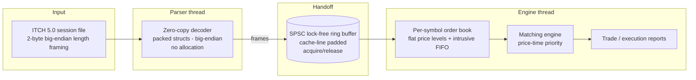

<div align="center">

# MatchCore

### Low-Latency Limit Order Book & Matching Engine in C++20

[](https://github.com/yadavchandan84/matchcore-engine/actions/workflows/ci.yml)


</div>

MatchCore parses **NASDAQ TotalView-ITCH 5.0** market data, rebuilds the
per-symbol limit order book, and runs a matching engine with strict
**price-time priority**. Its hot path performs **zero heap allocation**.
It is a from-scratch study of how production trading infrastructure is
engineered: zero-copy binary parsing, cache-friendly data layout, and a
lock-free handoff between the parser and engine threads.

> **Project status: v1.0.0, all 7 phases complete.**
> Parser, reference and optimized books, matching engine, SPSC pipeline and
> benchmarks are implemented and tested on GCC and Clang, with ASan, UBSan
> and TSan.

| Measured (synthetic 5M-message replay, Ryzen 7 5800H, WSL2) | |
| --- | --- |
| Parse + full-depth book rebuild | **14.7 M msgs/s**, p50 80 ns, p99 311 ns, p99.9 751 ns |
| Naive `std::map` reference book, same input | 5.2 M msgs/s |
| Parser alone (decode every message) | 105 M msgs/s, 3.0 GiB/s |
| Matching engine, mixed limit/IOC/cancel flow | 21.8 M requests/s |
| Heap allocations during replay / matching | **0** (asserted by `alloc_test`) |

Methodology and the full tables are in [`BENCHMARKS.md`](BENCHMARKS.md).

---

## Why this project is interesting

- **Real data, not toys.** It is validated against an actual multi-gigabyte
  NASDAQ ITCH 5.0 session file, not hand-written fixtures alone.
- **Zero-allocation hot path.** Orders and price levels come from pre-allocated
  pools; no `new`/`delete` while messages are flowing.
- **Correctness is provable.** A deliberately simple reference book is run
  side-by-side with the fast book, and property/fuzz tests plus real-file replay
  checkpoints confirm they always agree.
- **Measured, never guessed.** Every performance number is pasted from real
  command output, with the exact machine spec recorded.

---

## Architecture



**Key design choices (full rationale in [`docs/DESIGN.md`](docs/DESIGN.md)):**

| Decision | Why |
| --- | --- |
| Prices as raw scaled integers (`Price (4)`) | Exact comparisons and no floating-point drift between the fast and reference books |
| `Stock Locate` used as a direct array index | ITCH assigns it as a dense daily index, so no symbol hashing is needed |
| Alignment-1 wire structs + `memcpy` decode | Exact layouts pinned by `static_assert`, with no `#pragma pack` and no `reinterpret_cast` UB |
| Handlers as template parameters | Every `on(msg)` call resolves at compile time, with no virtual dispatch. Messages a handler ignores are never decoded |
| Flat sorted ladder, best price at `back()` | Top-of-book changes touch the end of a contiguous array instead of `std::map` nodes |
| Intrusive FIFO with 32-bit pool handles | O(1) execute, cancel and delete, compact nodes, no allocation |
| Open-addressing id map, identity hash | Sequential ITCH ids land in adjacent slots: 2.4× faster replay than a mixing hash (measured) |
| SPSC ring with acquire/release + cached indices | No locks or CAS; steady-state ops touch no cache line owned by the other core |
| Naive reference book as an oracle | A differential test checks every step of 100k random operations |

---

## Roadmap

| Phase | Scope | Status |
| ----- | ----- | ------ |
| 1 | Skeleton, presets, lint/format, CI, core types, smoke tests | ✅ Done |
| 2 | ITCH 5.0 parser: zero-copy, packed structs, big-endian, `static_assert` sizes | ✅ Done |
| 3 | Naive order book + obviously-correct reference implementation | ✅ Done |
| 4 | Optimized flat-level book, O(1) cancel via custom open-addressing map | ✅ Done |
| 5 | Matching engine: limit / market / IOC / FOK / cancel / modify | ✅ Done |
| 6 | SPSC lock-free pipeline (parser → ring buffer → engine) | ✅ Done |
| 7 | Google Benchmark + replay benchmark, perf profile, full docs | ✅ Done |

---

## Usage

### Rebuild a book from ITCH

```cpp
#include "matchcore/book/itch_book_builder.hpp"
#include "matchcore/book/order_book.hpp"
#include "matchcore/itch/parser.hpp"

matchcore::OrderBook book;                      // pools sized from OrderBook::Config
matchcore::ItchBookBuilder builder(book);
auto r = matchcore::itch::parse_stream(bytes, builder);  // bytes: std::span<const std::byte>
// r.bytes_consumed ends on a frame boundary: carry the tail into the next chunk.

if (auto bid = book.best(locate, matchcore::Side::kBuy)) {
  // bid->price.raw(), bid->total_shares, bid->order_count
}
```

### Write your own handler

Implement only the messages you need. Every other type is length-checked
and never decoded.

```cpp
struct TradePrinter {
  void on(const matchcore::itch::Trade& t) { /* t.stock.view(), t.price, t.shares */ }
};
```

### Match orders

```cpp
#include "matchcore/engine/matching_engine.hpp"
using namespace matchcore;

MatchingEngine engine;
struct Sink { void on_fill(const Fill& f) { /* f.maker_id, f.price, f.quantity */ } } sink;

engine.submit({/*locate*/ 1, /*id*/ 1, Side::kSell, OrderType::kLimit, TimeInForce::kGtc,
               Price{1'000'000}, 100}, sink);                 // rests at 100.0000
auto rep = engine.submit({1, 2, Side::kBuy, OrderType::kLimit, TimeInForce::kIoc,
                          Price{1'000'100}, 60}, sink);       // fills 60 @ 100.0000
```

### Tools

| Tool | Purpose |
| --- | --- |
| `matchcore_demo` | Guided tour: rebuilds books from ITCH and prints a depth ladder, then walks the matching engine through limit, FOK, market and modify/cancel scenarios |
| `itch_inspect <file> [max]` | Stream a `.NASDAQ_ITCH50` file and print counts per message type and the time range. Exits non-zero on corrupt input |
| `itch_gen <out> [msgs] [symbols] [seed]` | Write a deterministic synthetic session with real ITCH framing |
| `replay_bench [--file F \| --synthetic N] [--book fast\|ref]` | Replay throughput plus per-message p50/p99/p99.9 latency |
| `tools/run_benchmarks.sh [file]` | Build Release and run every benchmark in `BENCHMARKS.md` |
| `tools/profile.sh [--flamegraph]` | `perf record` the replay and print the hottest symbols |
| `tools/verify_all.sh [--bench]` | Run every check: all 4 compiler builds, both sanitizers, demo, ITCH tools, replay benchmark |
| `tools/check.sh <gcc\|clang> <Debug\|Release> [asan\|tsan]` | Build and test one configuration out of tree |

---

## Build

Requires **CMake ≥ 3.24**, **Ninja**, and a C++20 compiler (**GCC 13+** or
**Clang 16+**). GoogleTest, and Google Benchmark when enabled, are fetched
automatically. Benchmarks are opt-in: `-DMATCHCORE_BUILD_BENCHMARKS=ON`.
On Windows, build inside WSL2.

```bash
# Configure, build, and test (GCC, optimized)
cmake --preset gcc-release
cmake --build --preset gcc-release
ctest --preset gcc-release
```

### Available presets

| Preset | Compiler | Build type | Extra |
| ------ | -------- | ---------- | ----- |
| `gcc-debug` / `gcc-release` | GCC | Debug / Release | — |
| `clang-debug` / `clang-release` | Clang | Debug / Release | — |
| `asan` | Clang | Debug | AddressSanitizer + UBSan |
| `tsan` | Clang | Debug | ThreadSanitizer |

```bash
# Example: run the sanitized build
cmake --preset asan
cmake --build --preset asan
ctest --preset asan
```

---

## Project layout

```
matchcore-engine/
├── include/matchcore/
│   ├── types.hpp        # Price, Side, OrderId, StockLocate, Symbol
│   ├── itch/            # wire layouts, decoded messages, parser, synthetic generator
│   ├── book/            # OrderBook, ReferenceBook, IndexPool, OrderIdMap, ItchBookBuilder
│   ├── engine/          # MatchingEngine
│   └── pipeline/        # SpscRing, BookEvent, Pipeline
├── src/                 # Non-template implementation
├── tests/               # GoogleTest suites + zero-allocation proof (alloc_test)
├── bench/               # Google Benchmark microbenchmarks
├── tools/               # itch_inspect, itch_gen, replay_bench, helper scripts
├── docs/
│   ├── DESIGN.md        # Design decisions and rationale
│   └── specs/           # NASDAQ TotalView-ITCH 5.0 specification
├── .github/workflows/   # CI: GCC + Clang × Debug + Release, plus sanitizers
├── CMakePresets.json
├── BENCHMARKS.md        # Machine spec + measured results
└── LICENSE
```

---

## Data

The real NASDAQ ITCH sample (`*.NASDAQ_ITCH50`, several GB) lives in
`data/` and is **git-ignored**, so it is never committed. NASDAQ publishes
sample days at `https://emi.nasdaq.com/ITCH/Nasdaq%20ITCH/`. Decompress one
first (`gunzip -k <day>.NASDAQ_ITCH50.gz`), then:

```bash
./build/<preset>/bin/itch_inspect data/<day>.NASDAQ_ITCH50
./build/<preset>/bin/replay_bench --file data/<day>.NASDAQ_ITCH50
```

The feed is a stream of messages, each prefixed by a 2-byte big-endian
length. Tests and CI use deterministic synthetic sessions with identical
framing (`itch_gen`), so nothing depends on the large file.

---

## Testing & quality

144 tests in total:

- **Unit tests** (GoogleTest) for all 23 ITCH message types, field by field,
  plus every matching edge case: price-time priority, partial fills,
  IOC/FOK, market sweeps, modify priority rules.
- **Differential tests.** 100k random operations run against `OrderBook`
  and the naive `ReferenceBook`, with state compared after every step.
- **Property tests.** Under random matching flow, the book is never crossed
  and shares are conserved.
- **Pipeline test.** A two-thread replay through a tiny ring must produce
  exactly the book of the single-threaded reference.
- **Zero-allocation proof.** `alloc_test` counts global `operator new`
  calls during the hot path and requires 0.
- **Sanitizers.** ASan, UBSan and TSan run locally and in CI.
- **CI** builds the GCC + Clang × Debug + Release matrix, the sanitizers,
  and a short benchmark smoke run on every push.

---

## Benchmarks

`tools/run_benchmarks.sh` regenerates every number. The harness reports
throughput and per-message latency percentiles (p50 / p99 / p99.9) after a
warm-up, over multiple runs. [`BENCHMARKS.md`](BENCHMARKS.md) has the
before/after table for each optimization step, the microbenchmarks, a
`perf` profile, and notes on measurement noise.

> Measurements were taken on **Windows 11 + WSL2**, where timer noise is
> higher than on bare metal, so expect wider tails. All published figures
> use synthetic input. Numbers for a real NASDAQ day will be added after a
> run against the real file.

---

## License

Released under the [MIT License](LICENSE).

---

<div align="center">
<sub>Built as a deep-dive into low-latency market data systems. ITCH 5.0 spec © Nasdaq, Inc.</sub>
</div>

## 👤 Author

**Chandan Yadav**

📧 [yadavchandan6103@gmail.com](mailto:yadavchandan6103@gmail.com)
🔗 [GitHub](https://github.com/yadavchandan84) · [LinkedIn](https://www.linkedin.com/in/chandan-yadav-89aaa3253/)

<div align="center">

⭐ If you found this project useful, consider giving it a star.

</div>
