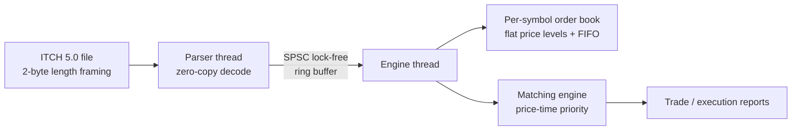

# MatchCore

[](https://github.com/yadavchandan84/matchcore-engine/actions/workflows/ci.yml)


MatchCore is a low-latency limit order book and matching engine in C++20. It
parses NASDAQ TotalView-ITCH 5.0 binary data, rebuilds the per-symbol book, and
runs a price-time-priority matching engine with a zero-allocation hot path.

> Status: **Phase 1 — skeleton + CI**. The parser, order book, matching engine
> and pipeline arrive in later phases. See the development plan below.

## Architecture (target)



## Development phases

1. **Skeleton + CI** (this phase) — build system, presets, lint/format, CI, smoke test.
2. ITCH 5.0 parser — zero-copy, packed structs, big-endian decode.
3. Naive book + reference implementation.
4. Optimized flat-level book with O(1) cancel.
5. Matching engine (limit / market / IOC / FOK / cancel / modify).
6. SPSC lock-free pipeline.
7. Benchmarks + full docs.

## Build

Requires CMake >= 3.24, Ninja, and a C++20 compiler (GCC 13+ or Clang 16+).

```bash
cmake --preset gcc-release
cmake --build --preset gcc-release
ctest --preset gcc-release
```

Other presets: `gcc-debug`, `clang-debug`, `clang-release`, `asan`, `tsan`.

## Layout

```
include/matchcore/   public headers
src/                 library implementation
tests/               GoogleTest unit tests
bench/               Google Benchmark microbenchmarks (later phases)
tools/               ITCH downloader / inspector utilities (later phases)
docs/                design docs and the ITCH 5.0 specification
```

## Data

The real NASDAQ ITCH sample (several GB, `*.NASDAQ_ITCH50`) lives in `data/`
and is **git-ignored**. It is never committed. See `tools/` (later phases) for
how to obtain and slice it.

## Design, benchmarks, limitations

- Design decisions: [`docs/DESIGN.md`](docs/DESIGN.md)
- Measured performance: [`BENCHMARKS.md`](BENCHMARKS.md)

## License

MIT. See [`LICENSE`](LICENSE).
