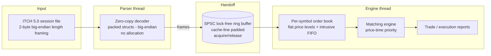

<div align="center">

# MatchCore

### Low-Latency Limit Order Book & Matching Engine in C++20

[](https://github.com/yadavchandan84/matchcore-engine/actions/workflows/ci.yml)


</div>

MatchCore parses real **NASDAQ TotalView-ITCH 5.0** market data, rebuilds the
per-symbol limit order book, and runs a matching engine with strict
**price-time priority** — on a hot path that performs **zero heap allocation**.
It is built as a from-scratch, interview-grade study of how production trading
infrastructure is engineered: zero-copy binary parsing, cache-friendly data
layout, and a lock-free handoff between parser and engine threads.

> **Project status — Phase 1 of 7: skeleton + CI.**
> The build system, toolchain matrix, CI, and core value types are in place and
> green. The parser, order book, matching engine, and pipeline land in the
> phases below. Each phase is built, tested, benchmarked, and documented before
> the next begins.

---

## Why this project is interesting

- **Real data, not toys.** It is validated against an actual multi-gigabyte
  NASDAQ ITCH 5.0 session file, not hand-written fixtures alone.
- **Zero-allocation hot path.** Orders and price levels come from pre-allocated
  pools; no `new`/`delete` while messages are flowing.
- **Correctness is provable.** A deliberately simple reference book is run
  side-by-side with the fast book, and property/fuzz tests plus real-file replay
  checkpoints confirm they always agree.
- **Measured, never guessed.** Every performance number is pasted from real
  command output, with the exact machine spec recorded.

---

## Target architecture



**Design choices already locked in (see [`docs/DESIGN.md`](docs/DESIGN.md)):**

| Decision | Why |
| --- | --- |
| Prices as raw scaled integers (`Price (4)`) | Exact, branch-free comparisons; no floating-point drift between fast and reference books |
| `Stock Locate` used as a direct array index | ITCH assigns it as a dense per-day index — no symbol hashing needed |
| Warning/sanitizer flags on `INTERFACE` targets | Strict on our code, lenient on third-party sources (GoogleTest) |
| GoogleTest via pinned `FetchContent` | Reproducible builds with no system dependency |

---

## Roadmap

| Phase | Scope | Status |
| ----- | ----- | ------ |
| 1 | Skeleton, presets, lint/format, CI, core types, smoke tests | ✅ Done |
| 2 | ITCH 5.0 parser — zero-copy, packed structs, big-endian, `static_assert` sizes | ⏳ Next |
| 3 | Naive order book + obviously-correct reference implementation | ⬜ |
| 4 | Optimized flat-level book, O(1) cancel via custom open-addressing map | ⬜ |
| 5 | Matching engine — limit / market / IOC / FOK / cancel / modify | ⬜ |
| 6 | SPSC lock-free pipeline (parser → ring buffer → engine) | ⬜ |
| 7 | Google Benchmark + replay benchmark, flame graphs, full docs | ⬜ |

---

## Build

Requires **CMake ≥ 3.24**, **Ninja**, and a C++20 compiler (**GCC 13+** or
**Clang 16+**). GoogleTest is fetched automatically.

```bash
# Configure, build, and test (GCC, optimized)
cmake --preset gcc-release
cmake --build --preset gcc-release
ctest --preset gcc-release
```

### Available presets

| Preset | Compiler | Build type | Extra |
| ------ | -------- | ---------- | ----- |
| `gcc-debug` / `gcc-release` | GCC | Debug / Release | — |
| `clang-debug` / `clang-release` | Clang | Debug / Release | — |
| `asan` | Clang | Debug | AddressSanitizer + UBSan |
| `tsan` | Clang | Debug | ThreadSanitizer |

```bash
# Example: run the sanitized build
cmake --preset asan
cmake --build --preset asan
ctest --preset asan
```

---

## Project layout

```
matchcore-engine/
├── include/matchcore/   # Public headers (types, version, and later: parser, book, engine)
├── src/                 # Library implementation
├── tests/               # GoogleTest unit tests
├── bench/               # Google Benchmark microbenchmarks        (Phase 7)
├── tools/               # ITCH downloader / inspector / slicer     (later phases)
├── docs/
│   ├── DESIGN.md        # Design decisions and rationale
│   └── specs/           # NASDAQ TotalView-ITCH 5.0 specification
├── .github/workflows/   # CI: GCC + Clang × Debug + Release, plus sanitizers
├── CMakePresets.json
├── BENCHMARKS.md        # Machine spec + measured results
└── LICENSE
```

---

## Data

The real NASDAQ ITCH sample (`*.NASDAQ_ITCH50`, several GB) lives in `data/`
and is **git-ignored — it is never committed**. The feed is a stream of
messages, each prefixed by a 2-byte big-endian length. Tooling to download and
slice a small test fixture from it arrives in a later phase under `tools/`.

---

## Testing & quality

- **Unit tests** (GoogleTest) for every message type and matching edge case.
- **Property/fuzz tests** comparing the fast book against the reference book.
- **Replay tests** validating rebuilt book state against checkpoints derived
  from the real ITCH file.
- **Sanitizers** — ASan, UBSan, and TSan run locally and in CI.
- **CI** builds the full GCC + Clang × Debug + Release matrix on every push.

---

## Benchmarks

Performance work is Phase 7. The harness reports throughput (msgs/sec) and
latency percentiles (p50 / p99 / p99.9) with warmup and multiple runs, and
`BENCHMARKS.md` holds a before/after table for each optimization
(naive `std::map` → flat levels → pool allocator → SPSC pipeline).

> Development and measurement happen on **Windows 11 + WSL2**, where timer noise
> is higher than on bare metal — expect wider tails. The methodology and the
> `perf` flame-graph workflow (with a WSL2 fallback) are documented alongside
> the results.

Current machine spec is recorded in [`BENCHMARKS.md`](BENCHMARKS.md).

---

## License

Released under the [MIT License](LICENSE).

---

<div align="center">
<sub>Built as a deep-dive into low-latency market data systems. ITCH 5.0 spec © Nasdaq, Inc.</sub>
</div>
