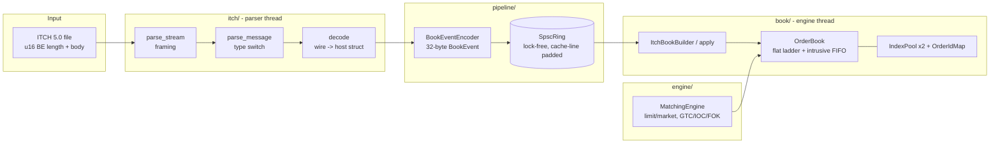

# MatchCore Design

This document describes MatchCore's architecture and the reasoning behind
each design decision. Measured evidence for the performance claims is in
[`BENCHMARKS.md`](../BENCHMARKS.md).

## Goals and constraints

- Parse NASDAQ TotalView-ITCH 5.0 binary data and rebuild the full-depth
  limit order book for every symbol.
- Run a matching engine with strict price-time priority.
- **Zero heap allocation on the hot path.** Memory for orders, levels and
  the id index is preallocated at startup. This is verified by `alloc_test`
  rather than assumed.
- No raw `new`/`delete`, RAII everywhere, `noexcept` on the hot path, and no
  exceptions or virtual calls in it.
- Correctness is checked against a deliberately naive reference
  implementation, not only by hand-written cases.

## Architecture

The project has four layers. Each one is usable on its own, and each
depends only on the layers to its left:

| Layer | Headers | Responsibility |
| --- | --- | --- |
| Parser | `itch/wire.hpp`, `itch/messages.hpp`, `itch/parser.hpp` | bytes → typed messages → handler callbacks |
| Book | `book/order_book.hpp`, `book/reference_book.hpp`, `book/itch_book_builder.hpp` | per-symbol full-depth book from ITCH order flow |
| Engine | `engine/matching_engine.hpp` | accepts new orders and matches them with price-time priority |
| Pipeline | `pipeline/spsc_ring.hpp`, `pipeline/book_event.hpp`, `pipeline/pipeline.hpp` | parser and book on separate threads |

Two consumers sit on top of the `OrderBook`. `ItchBookBuilder` *replays*
the exchange's own decisions: ITCH tells us what executed. `MatchingEngine`
*makes* matching decisions for orders submitted to it. Both share the same
book data structure.

## Core types (`types.hpp`)

- **Fixed-point prices.** ITCH `Price (4)` is a `u32` with 4 implied
  decimals. `Price` stores that raw integer and never converts to floating
  point. Comparisons are exact, and the fast and reference books cannot
  disagree through FP rounding. The 8-decimal `Price (8)` fields (MWCB
  levels) are kept as raw `u64`.
- **Stock Locate as an array index.** ITCH assigns each symbol a dense
  daily `u16` locate code. `OrderBook` indexes a 65,536-entry symbol table
  with it directly, so no symbol hashing is needed.
- **`FixedString<N>` / `Symbol`.** Space-padded alpha fields are stored raw.
  `view()` trims the padding without copying.

## Parser (`itch/`)

**Wire layer.** Every message has a struct made only of byte arrays
(`BeUint<N>`, `Alpha<N>`, `char`). Alignment is therefore 1, so there is no
padding and `sizeof` equals the wire size without any `#pragma pack`. A
`static_assert` pins all 23 message sizes to the spec, so a wrong field is
a compile error.

**No `reinterpret_cast`.** Casting a byte pointer to a struct pointer is
undefined behaviour in C++20: no object of that type exists there. The
parser instead `memcpy`s the body into a local wire struct, which is well
defined for trivially-copyable types. GCC and Clang lower it to direct loads
of the fields that are actually used. `BeUint<N>::value()` builds the
integer with shifts, which compiles to `bswap`/`movbe`.

**Static dispatch.** `parse_message<Handler>` switches on the type byte and
calls `handler.on(const Msg&)`. The handler is a template parameter, so
every call resolves at compile time and can be inlined, with no virtual
calls. A `HandlesMessage` concept plus `if constexpr` means a handler
implements only the overloads it needs. Message types it ignores are only
length-checked, never decoded.

**Error policy.** Errors are values (`ParseError`), never exceptions:

- A known type with the wrong body length gives `kBadLength`.
- An unknown type gives `kUnknownType`.
- An invalid Buy/Sell byte gives `kInvalidField`.

`parse_stream` counts and skips bad frames. The length prefix still frames
the stream correctly, so one bad message cannot desynchronize the rest.

**Chunked input.** `parse_stream` stops at the first incomplete frame and
returns `bytes_consumed`, which always lands on a frame boundary. A reader
moves the tail to the front of its buffer and appends the next read; see
`itch_inspect` and `replay_bench`. A test splits a stream at every possible
byte offset and checks that the results are identical.

## Order book (`book/`)

### Reference book

`ReferenceBook` is built only from standard containers:

- `std::map` for price levels
- `std::list` for each level's FIFO queue
- `std::unordered_map` for order lookup

It is obviously correct, allocation-heavy and slow. It exists to be the
oracle.

### Optimized book

`OrderBook` has the same public API, built from three pieces.

- **Pools with 32-bit handles.** `IndexPool<T>` is a fixed array with an
  O(1) free list. Orders and levels link to each other with `u32` indices
  instead of pointers. That halves the link size and keeps nodes compact.
  When a pool is full, `allocate()` fails loudly (`kCapacityExceeded`)
  instead of growing.
- **Intrusive FIFO.** Each order node carries `prev`/`next` links and the
  index of its level. Execute, cancel and delete therefore never search: a
  lookup by id gives the node, and the node gives its level.
- **Flat ladder.** Each symbol side keeps a sorted `std::vector<{price,
  level}>` ordered worst to best, so the best price is `back()`. Most real
  activity is near the top of book, so inserting or erasing a level near
  `back()` shifts only a few 8-byte entries, and the ladder is contiguous in
  memory. A `std::map` would instead allocate a node per level and chase
  pointers.

Complexity:

| Operation | Cost |
| --- | --- |
| add | O(log L) to find or create the level |
| execute / cancel / delete | O(1), plus O(log L) when a level empties |
| best / front | O(1) |

**Order-id index (`OrderIdMap`).** An open-addressing table with linear
probing:

- The table is a power of two and at least 2× the maximum entries, so the
  load factor stays ≤ 0.5.
- Deletion uses backward shift instead of tombstones, so the insert/erase
  churn of a trading day never degrades lookups.

The default hash is the **identity**. ITCH ids are sequential, so live
orders are a sliding window of nearby ids. Identity maps that window onto
adjacent slots, making lookups cache-friendly with almost no collisions.
Replacing a Murmur finalizer with identity took replay from 6.0 to 14.7 M
msgs/s (see BENCHMARKS.md). For id streams that are not sequential, or may
be adversarial, `-DMATCHCORE_IDMAP_MIX_HASH` restores the mixing hash.
Correctness is unaffected either way, and a test covers the worst-case
single-cluster pattern.

**Allocation contract.** The pools and the id map are sized from `Config`
at construction. Ladder vectors reserve `levels_per_side` for locates
`1..symbols_reserved`. They grow only if a side gets deeper than that, and
they never shrink, so the steady state performs no allocation. `alloc_test`
checks this with zero `operator new` calls over a 1M-message replay.

**Failure atomicity.** Every rejected operation leaves the book unchanged.
`replace` checks level capacity *before* removing the old order, so it can
never fail halfway.

**ITCH mapping** (`ItchBookBuilder`):

| ITCH message | Book operation |
| --- | --- |
| `A`, `F` | add |
| `E`, `C` | execute (`C`'s price is the trade print; book state is unaffected) |
| `X` | partial cancel |
| `D` | delete |
| `U` | replace: keeps side, loses time priority |
| `P`, `Q`, `B` | no book effect: non-displayed, cross, broken trade |

## Matching engine (`engine/`)

`MatchingEngine` owns an `OrderBook` and matches against the opposite best
level first. Within a level it takes the oldest order first. Trades print at
the **resting** order's price. Fills go to a template sink, `on_fill`,
statically dispatched and in execution order.

| Type | Behaviour |
| --- | --- |
| Limit GTC | match up to the limit, rest the remainder |
| Limit IOC | match up to the limit, cancel the remainder |
| Limit FOK | pre-check available shares within the limit; fill fully or reject with no side effects |
| Market IOC / FOK | match at any price, never rest. Market + GTC is rejected |
| Cancel | remove a resting order |
| Modify | quantity decrease at the same price **keeps** priority. A price change or quantity increase **loses** priority and is re-submitted as limit GTC, so it can match if it now crosses |

The FOK pre-check walks levels only until it has enough shares. All
validation happens before any fill, so a rejected request changes nothing.

Out of scope: self-trade prevention, stop orders, auctions,
hidden/iceberg quantity. The tests check two invariants under 50k random
requests: the book is never crossed, and shares are conserved
(`submitted = resting + 2 × traded + cancelled`).

## Pipeline (`pipeline/`)

**`SpscRing<T, N>`** is a bounded single-producer/single-consumer queue with
no locks and no CAS:

- `tail_` is written only by the producer and `head_` only by the consumer.
- The producer writes the slot, then publishes it with a **release** store
  to `tail_`. The consumer's **acquire** load of `tail_` sees the slot
  contents. The symmetric pair on `head_` returns slots.
- `seq_cst` is unnecessary because each index has a single writer, and
  neither thread needs to agree on an order between the two indices.
- Each side caches the other side's index and reloads it only when the ring
  looks full or empty. A steady-state push or pop touches no cache line
  owned by the other core.
- Producer state, consumer state and the slots each sit on their own
  64-byte line, which avoids false sharing.
- Indices are free-running 64-bit counters: no wrap ambiguity, and the full
  capacity is usable.

**`BookEvent`** is a fixed 32-byte POD, two per cache line. The parser side
converts only book-changing ITCH messages, so the ring carries nothing the
engine would drop.

**`Pipeline`.** The caller's thread parses and pushes. One consumer thread
owns the book until `run()` joins it, and the join also publishes the final
book state. Waits spin 64 times and then `yield()`. That keeps latency low
while still behaving well on few-core VMs (CI, WSL2).

A test checks that a two-thread replay through a 256-slot ring produces
exactly the same book as the single-threaded reference. It runs under
ThreadSanitizer in CI.

## Verification strategy

| Technique | Where |
| --- | --- |
| Compile-time wire sizes for all 23 ITCH messages | `wire.hpp` |
| Field-level decode test per message type, from bytes built independently in spec order | `itch_parser_test.cpp` |
| Stream framing, malformed frames, and split-at-every-offset chunking | `itch_parser_test.cpp` |
| Typed tests run identical scenarios on both books | `book_test.cpp` |
| Differential test: 100k random ops, `OrderBook` vs `ReferenceBook` after every step | `book_test.cpp` |
| `OrderIdMap` vs `std::unordered_map` under 200k random ops | `book_test.cpp` |
| Engine scenarios plus random-flow invariants | `matching_engine_test.cpp` |
| Two-thread pipeline vs single-thread reference | `pipeline_test.cpp` |
| Zero allocation on the hot path | `alloc_test.cpp` |
| Generate a fixture, then inspect it with the CLI | `tools/CMakeLists.txt` |
| GCC + Clang × Debug + Release, ASan + UBSan, TSan | CI |
